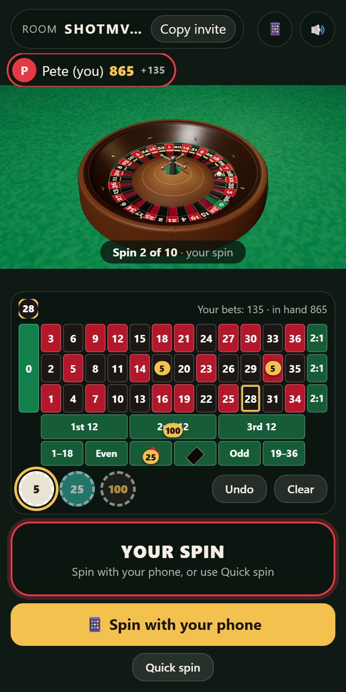
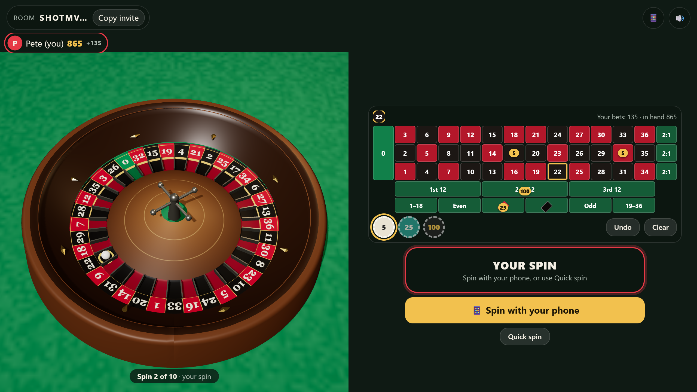

# Roulette

Multiplayer 3D roulette for the web and Discord. Everyone bets on one shared table, and players take turns spinning: **twist your phone to spin the wheel, then flick it to launch the ball.** Play chips only: no real money, no prizes.

| | |
|---|---|
| **Play in a browser** | https://roulette.housetandem.com |
| **In Discord** | Coming once the Discord application is set up (see below) |

Built with Three.js, the DeviceMotion API, PeerJS (WebRTC) and a Cloudflare Worker with a Durable Object relay. It's the sibling of [7, 11, Doubles](https://github.com/petegordon/discord-activity-dice) and shares its networking and Discord plumbing. See [PLAN.md](PLAN.md) for the design.

| Phone | Desktop / Discord |
|---|---|
|  |  |

## How to play

1. Open the site. It creates a room and puts its code in the URL. Use **Copy invite** to share it.
2. The first player in the room is the host. The host picks 5, 10 or 20 spins and presses **Start game**.
3. Everyone starts with **1,000 chips**. Pick a chip (5, 25 or 100) and tap the table to bet on a number (35:1), red/black, odd/even, 1–18/19–36 (1:1), or a dozen or column (2:1). **Undo** and **Clear** take chips back.
4. On your spin: **hold the spin zone and twist your phone like a dial** to spin the wheel. When you hear the **chime** (the pad says **NOW FLICK!**), snap your wrist to launch the ball. On iPhone, tap **Enable motion to spin** first.
5. Bets close when the ball is launched. When it lands, winners are paid and the next player spins.
6. Most chips after the last spin wins.

**New to it?** [**🎓 Learn to spin**](https://roulette.housetandem.com/practice) is a practice wheel that walks you through it on your own phone with animations and spoken coaching, ending with spins done by ear, since you can't watch the screen while you twist. It's linked from the lobby and the phone remote.

**No motion sensors?** In Discord or on a desktop, use **📱 Spin with your phone** (below) or **Quick spin**.

## 📱 Spin with your phone

Discord doesn't let Activities read a phone's motion sensors, so any phone can spin for your seat:

1. Tap **📱** (top right, or **Spin with your phone** in the lobby). The table shows a QR code and the link.
2. Scan it with a phone's camera and tap **Tap to connect**.
3. On your turn, twist the phone, then flick it. The wheel spins on the table, and the phone shows the result once the ball lands.

**New link** stops the old link working, and **Unpair** stops using the phone. Anyone with your link can spin for you, so don't show the code on a stream. Details are in [SPINNER-REMOTE.md](SPINNER-REMOTE.md).

## Development

```bash
npm install
npm test              # unit tests (Vitest)
npm run typecheck     # app + worker
npm run build         # type-check + Vite build to dist/
npm run preview       # build, then serve app + Worker + Durable Object at http://127.0.0.1:8787
```

`npm run dev` starts Vite with hot reload and proxies `/api` to `wrangler dev` on :8787.

DeviceMotion, WebCrypto and WebRTC need **HTTPS**, so test on phones with the deployed site (or an HTTPS tunnel).

### End-to-end tests

With `npm run preview` running:

```bash
node scripts/e2e.mjs http://127.0.0.1:8787 relay 3        # or: peerjs 3
node scripts/e2e-remote.mjs http://127.0.0.1:8787 relay   # or: peerjs
node scripts/e2e-practice.mjs http://127.0.0.1:8787
node scripts/e2e-deploy.mjs http://127.0.0.1:8787
```

- `e2e.mjs` has headless players bet and play a 5-spin game with Quick spin. It checks that everyone saw the same pockets and chip counts, and that chips add up against the recorded payouts.
- `e2e-remote.mjs` pairs a phone that spins with synthetic twist-and-flick motion. It also covers a host leaving mid-game and **New link** revoking the old phone.
- `e2e-practice.mjs` walks every Learn to spin lesson with synthetic motion, including a wrong-axis twist that should earn a tip.
- `e2e-deploy.mjs` checks that a page caught mid-deploy reloads itself (`public/boot-guard.js`).

Screenshots go to `scripts/out/`. Add `&nomotion` to a table URL for the no-motion layout, `&t=relay` for the relay transport, and `&debug` to expose `window.roulette`.

## Deploying to Cloudflare

The Worker serves the static build, `/api/*` and the relay on the custom domain **roulette.housetandem.com**. Wrangler creates the DNS record on deploy, since the `housetandem.com` zone is on the same Cloudflare account.

```bash
npm run deploy
npx wrangler secret put DISCORD_CLIENT_SECRET   # once the Discord app exists
```

## Discord Activity setup

The same steps as the dice app ([its README](https://github.com/petegordon/discord-activity-dice#discord-activity-setup)), with this app's domain:

1. Create an application at https://discord.com/developers/applications and enable **Activities**.
2. **URL Mappings:** `/` → `roulette.housetandem.com` (and `/peerjs` → `0.peerjs.com` only if forcing `t=peerjs`).
3. **OAuth2 → Redirects:** exactly one, e.g. `https://127.0.0.1`.
4. Put the application ID in `wrangler.jsonc` (`vars.DISCORD_CLIENT_ID`) and `.env.production` (`VITE_DISCORD_CLIENT_ID`). Set the secret with `npx wrangler secret put DISCORD_CLIENT_SECRET`, then run `npm run deploy`.
5. **Terms of Service URL:** https://roulette.housetandem.com/terms · **Privacy Policy URL:** https://roulette.housetandem.com/privacy
6. **Installation:** Guild Install with `applications.commands`. Under **Supported Platforms**, tick iOS and Android.

## Project layout

```
src/
  main.ts                 boot: identity, transport, wiring
  ui.ts, style.css        DOM overlay: lobby, players, betting table, spin zone, callouts
  audio.ts                synthesised ball roll, fret clacks, wheel ticks, flick chime, launch whoosh
  game/                   rules and payouts, pure game reducer, host authority
  wheel/spin.ts           spin plan, wheel friction, the deterministic ball path
  input/                  twist (gyro) + flick (accelerometer) detection, pointer fallback
  net/                    protocol, transports (PeerJS, relay), room coordination
  platform/               environment, identity/rooms, Discord SDK, motion detection
  remote/                 the 📱 spinner remote page (remote.html, served at /remote)
  practice/               Learn to spin (practice.html, served at /practice): lessons, demo, voice, twist coach
  render/scene.ts         Three.js wheel, ball and table
worker/src/               Worker: assets, /api/token, /api/ice, RelayRoom Durable Object, Discord room tickets
test/                     Vitest unit tests
scripts/                  Playwright end-to-end tests
```
